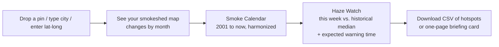
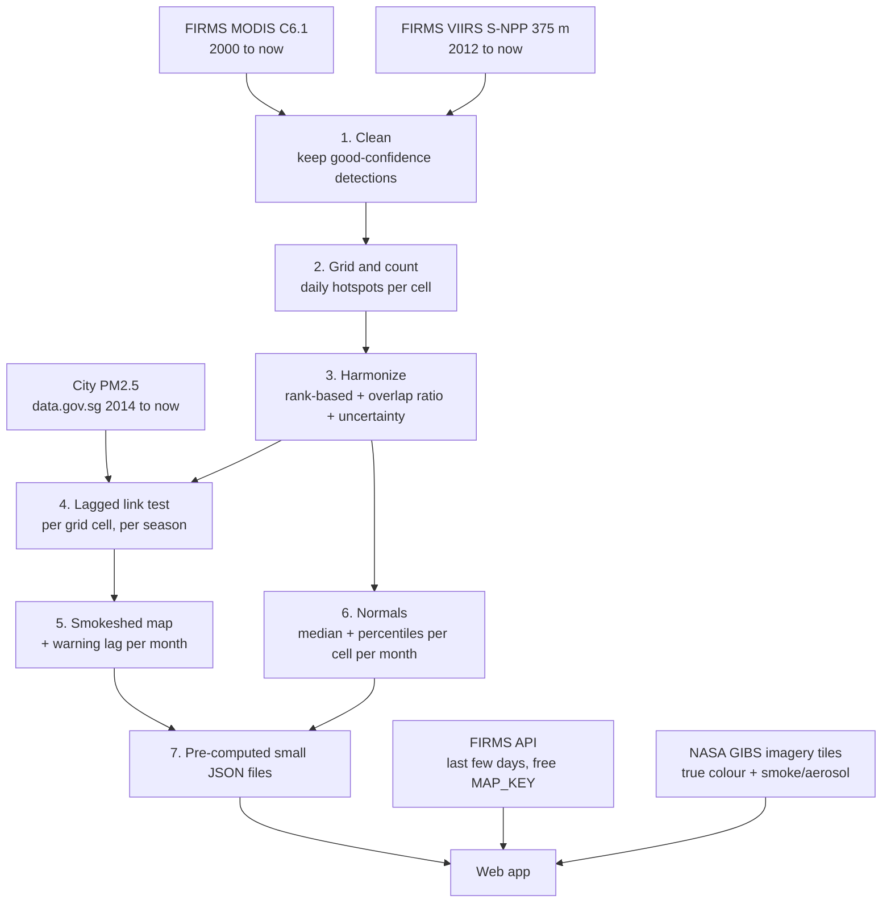

# Smokeshed: Workflow, Reasoning & Sources

> **NASA Space Apps Challenge 2026**: harmonized burning activity calendar challenge
> Status: workflow draft. Implementation decisions are listed in [Section 13](#13-open-decisions).

---

## 1. The challenge in one paragraph

Satellites have tracked active fire hotspots for over 20 years, but the record is split between two sensor families. **MODIS** (on Terra and Aqua) has the long history; **VIIRS** has finer detail and is the future. Their counts can't be compared directly because they differ in resolution, sensitivity and timing. The challenge asks for a web app that **harmonizes** MODIS and VIIRS into one consistent record and presents it as a **burning activity calendar** for a user-selected area, with comparisons against history and a CSV download.

---

## 2. Our idea: Smokeshed

> **A burning calendar for the people who breathe the smoke.**

The brief assumes the user cares about fires *inside* the area they select. But millions of people live far from any fire and still breathe its smoke. Singapore has almost no fires of its own, yet it is hit by transboundary haze from Sumatra and Kalimantan in many dry seasons.

**The flip:** instead of drawing a box around fires, the user **drops a pin where they live**. Smokeshed works out **which burning areas actually affect that location's air**, its *smokeshed*, and builds the harmonized burning calendar for that area.

> **Analogy:** a *watershed* is all the land whose rain ends up in your river. A *smokeshed* is all the land whose burning ends up in your lungs.

---

## 3. Why this matters (evidence)

| Point | Evidence |
|---|---|
| **It's happening now** | On 9 Oct 2026, Singapore's central-region 24-hr PSI reached 181, the worst reading of 2026. NEA attributed it to smoke from hotspots in southern/central Sumatra and West Kalimantan. [S1] |
| **It was predicted, but only seasonally** | A June 2026 regional Haze Outlook issued a rare "red" alert and flagged August–September as the peak danger period. [S2] |
| **The human cost is large** | A Harvard–Columbia study estimated ~100,300 premature deaths from the 2015 Southeast Asian haze (range ~26,300–174,300), including ~2,200 in Singapore, more than Singapore's road deaths over the prior decade combined. [S3][S4] |
| **Fire metrics ignore smoke harm** | Research notes that common wildfire severity metrics don't reflect the societal harm from smoke, and that linking smoke exposure to source fires is important for transboundary policy. [S5] |
| **The fire record is about to break** | NASA advises that Terra and Aqua (which carry MODIS) begin shutting down in late 2026/early 2027. [S6] Orbit drift is already affecting MODIS pixel size, scan gaps and time-of-day sampling. [S7] Harmonizing MODIS with VIIRS *now* keeps 20+ years of history usable. |

---

## 4. Why not just a "this month vs. normal" calendar?

A heatmap of raw hotspot counts, or "this month vs. the historical median", is the most obvious reading of the brief, so many teams will build it. Smokeshed **includes** that (it's required), but it adds two things others are unlikely to have:

1. **A new user group the brief overlooks:** people *downwind* of fires (city health agencies, schools, hospitals, outdoor workers, residents).
2. **A measurable result:** we can test whether hotspot surges in the smokeshed came *before* bad air in Singapore during the 2026 haze season (see [Section 10](#10-validation-plan)).

---

## 5. How it works (plain language)

### 5.1 Harmonizing MODIS and VIIRS

**Analogy:** MODIS and VIIRS are like two thermometers, one in °F and one in °C. VIIRS (375 m pixels) picks up smaller fires than MODIS (~1 km pixels), so it counts more hotspots for the same burning. [S8][S9] You can't just stack the numbers.

We use two methods together:

- **Method A: Rank, don't convert.** For each grid cell and month, ask "where does this month rank in *its own sensor's* history?" A 95th-percentile month is unusual on either thermometer. The calendar's **colours** use this, so they don't depend on which sensor took the reading.
- **Method B: Learn the "exchange rate" from the overlap.** MODIS data runs from Nov 2000 and VIIRS S-NPP 375 m from Jan 2012. [S10] Both flew together for over a decade. For each grid cell (falling back to larger regions where data is sparse), we compare monthly counts during the overlap and learn a local MODIS→VIIRS ratio. We then convert MODIS-only years (2001–2011) into **VIIRS-equivalent counts** so the **numbers** are comparable too.
- **Show uncertainty.** Converted years carry a ± range. We'd rather be honest than precise-looking.

**Engineering choice:** use **one** VIIRS satellite (Suomi NPP) for the long record so the same fire isn't double-counted by multiple VIIRS satellites. (NOAA-20 data, from Apr 2018 [S10], can be added later for near-real-time coverage.)

### 5.2 Learning the smokeshed (no atmospheric model needed)

Research usually traces smoke with heavy wind-trajectory models. [S5][S11] We use a statistical shortcut a hackathon team can build: **let history teach us.**

1. Split the region around the user's pin into grid squares (e.g. 0.5°).
2. For each square, ask: *"When this square has many hotspots, does the city's PM2.5 rise a few days later?"*
3. Test delays (lags) of 0–7 days and keep the strongest link.
4. Squares with a strong, consistent link = the **smokeshed**. The best lag = the **warning time** (e.g. "fires here usually reach you in ~2 days").
5. Repeat **per season/month**, because monsoon winds change direction and the smokeshed moves with them.

Training data for Singapore: hourly PM2.5 from data.gov.sg, available from Apr 2014. [S12] Other cities can use a global air-quality source such as OpenAQ.

### 5.3 Rebuilding history back to 2001

PM2.5 data for Singapore only starts in 2014, but once we know the smokeshed, the **harmonized** MODIS record lets us build the smoke-risk calendar back to **2001**, using years for which we have no air data at all. This is what ties the two halves of the challenge (harmonization + calendar) into one story.

---

## 6. User workflow

Four steps, no jargon. Optional "expert mode": draw your own area instead of using the learned smokeshed.

---

## 7. Data workflow

**Key engineering lesson:** do the heavy processing **once, offline** (steps 1–7) and save small files. The web app only reads ready-made results, so it stays fast, free to host, and won't crash during judging.

---

## 8. Screens

| Screen | What the user sees | Challenge requirement covered |
|---|---|---|
| **1. Where do you breathe?** | Pin / city search / lat-long. Map shades the smokeshed; month slider shows how it shifts with the monsoon. GIBS satellite imagery as basemap. | Interactive area selection |
| **2. Smoke Calendar** | Years × months grid (2001→now) of harmonized hotspots from the smokeshed. Colour-blind-safe ramp. Click a cell to see which source areas contributed. | Harmonized burning calendar, colour ramps |
| **3. Haze Watch** | Plain sentence, e.g. *"Hotspots in your smokeshed this week: 3.4× the September median. Based on past years, air quality typically worsens ~2 days later."* GIBS imagery of the current plume. | Current vs. historical median, early warning |
| **Export** | CSV of hotspots for the selected area and dates; one-page briefing card (PNG/PDF). | Downloadable CSV |

---

## 9. Data sources

| Data | Source | Used for |
|---|---|---|
| MODIS active fire (C6.1), Nov 2000→now | NASA FIRMS archive download [S10] | Long history |
| VIIRS S-NPP 375 m active fire, Jan 2012→now | NASA FIRMS archive download [S10] | Detail + continuity |
| Recent hotspots (last days) | NASA FIRMS API (free MAP_KEY) | Live Haze Watch |
| Singapore hourly PM2.5, Apr 2014→now | data.gov.sg (NEA) [S12] | Learning the smokeshed |
| Satellite imagery tiles (true colour, aerosol) | NASA GIBS | Basemap + visual proof of plumes |
| Notable fire events (optional) | NASA EONET | Labels on the calendar |

---

## 10. Validation plan

- **Hold out 2026.** Train the smokeshed on 2014–2025 only.
- **Test on the 2026 haze season** (Aug–Oct 2026): did hotspot surges in the learned smokeshed appear *before* Singapore's PSI/PM2.5 turned unhealthy, and by how many days?
- **Report honestly:** hits, misses, false alarms, typical lead time.
- This result is unique to our work and is the core of the demo.

---

## 11. Limitations (we state these up front)

- **A hotspot is not a fire.** One large fire can produce hundreds of hotspots.
- **Clouds and thick smoke hide hotspots**, so the worst periods may be undercounted.
- **Correlation ≠ causation.** The smokeshed is a statistical link, not a physical smoke-transport model. Local pollution and weather also affect PM2.5.
- **Wind patterns vary between years** (e.g. El Niño years), so the smokeshed and lag carry uncertainty.
- **MODIS data quality is changing** due to orbit drift. [S7]
- **Harmonized pre-2012 counts are estimates** and are shown with uncertainty ranges.

---

## 12. Challenge requirements checklist

- [x] Harmonize MODIS and VIIRS into a consistent time series
- [x] Burning activity calendar, early 2000s → present
- [x] User selects an area (pin, city, lat-long, or draw)
- [x] User selects a date range
- [x] Compare current month to historical median
- [x] Accessible colour ramps
- [x] Downloadable CSV of hotspots
- [x] Early-warning value for responders (plus a new downwind user group)

---

## 13. Open decisions

- Grid size (0.25° vs 0.5°)
- Lag range (0–7 days?) and how "strong link" is defined (threshold / significance test)
- FIRMS confidence filter for MODIS and VIIRS
- Overlap-ratio method: per cell vs per region vs per land-cover type
- Frontend stack (e.g. MapLibre or Leaflet + a charting library)
- Hosting (static site + pre-computed JSON)
- Second test city beyond Singapore (to show it generalizes)

---

## Sources

- **[S1]** Malay Mail (9 Oct 2026): *Singapore central region hits 2026 record of 181 PSI amid transboundary haze*. https://www.malaymail.com/news/singapore/2026/10/09/singapore-central-region-hits-2026-record-of-181-psi-amid-transboundary-haze/238371
- **[S2]** Mothership (9 Aug 2026): *Haze risk could increase in coming week due to dry conditions: NEA*. https://mothership.sg/2026/08/haze-risk-increase-nea/
- **[S3]** Durango Herald / AP: *100,000 deaths attributed to forest fire haze in Indonesia*. https://www.durangoherald.com/?p=117765
- **[S4]** Eco-Business: *SE Asian governments dismiss finding that 2015 haze killed 100,300*. https://www.eco-business.com/ms/news/se-asian-governments-dismiss-finding-that-2015-haze-killed-100300/
- **[S5]** PMC: *Linking source fires to smoke PM2.5 and health impacts* (contiguous US, 2006–2020). https://pmc.ncbi.nlm.nih.gov/articles/PMC10743475
- **[S6]** NASA Earthdata: *Transition from MODIS to VIIRS*. https://www.earthdata.nasa.gov/data/alerts-outages/transition-from-modis-viirs
- **[S7]** NASA LDOPE: *MODIS Terra/Aqua drift*. https://landweb.modaps.eosdis.nasa.gov/displayissue?id=1254
- **[S8]** NASA MODAPS: *VNP14IMGTDL_NRT, VIIRS (S-NPP) I-Band 375 m Active Fire Product*. https://modaps.modaps.eosdis.nasa.gov/services/about/products/viirs-land-c2-nrt/vnp14imgtdl_nrt.html
- **[S9]** NASA Earthdata: *Wildfires can't hide from Earth-observing satellites*. https://www.earthdata.nasa.gov/learn/articles/wildfire-articles/wildfires-cant-hide-from-earth-observing-satellites
- **[S10]** NASA FIRMS: *Archive Download* (temporal coverage). https://firms2.modaps.eosdis.nasa.gov/download/
- **[S11]** Wilmot et al., *Environmental Research Letters*: *Wildfire activity is driving summertime air quality degradation across the western US: a model-based attribution to smoke source regions*. https://iopscience.iop.org/article/10.1088/1748-9326/ac9a5d
- **[S12]** data.gov.sg (NEA): *Historical 1-hr PM2.5*. https://data.gov.sg/dataset/historical-1-hr-pm2-5
- NASA Space Apps Challenge 2026: challenge statement (harmonized burning activity calendar).
